<!-- SPDX-FileCopyrightText: 2026 Ai-chan-0411 <aoikabu12@gmail.com> -->
<!-- SPDX-FileCopyrightText: 2026 Apoorv Garg <apoorvgarg.21@gmail.com> -->
<!-- SPDX-FileCopyrightText: 2026 Aryan Iyappan <aryaniyappan2006@gmail.com> -->
<!-- SPDX-FileCopyrightText: 2026 Subramania Raja <dhanpraja231@gmail.com> -->
<!-- SPDX-FileCopyrightText: 2026 Hari Srinivasan <harisrini21@gmail.com> -->
<!-- SPDX-FileCopyrightText: 2026 Hemalatha Madeswaran <hemalathamadeswaran@gmail.com> -->
<!-- SPDX-FileCopyrightText: 2026 Kaushik Kumar <kaushikrjpm10@gmail.com> -->
<!-- SPDX-FileCopyrightText: 2026 Lokesh Selvam <lokeshselvam7025@gmail.com> -->
<!-- SPDX-FileCopyrightText: 2026 Naraen Rammoorthi <naraen13@gmail.com> -->
<!-- SPDX-FileCopyrightText: 2026 Shaan Narendran <shaannaren06@gmail.com> -->
<!-- SPDX-FileCopyrightText: 2026 Shreem Seth <shreemseth26@gmail.com> -->
<!-- SPDX-FileCopyrightText: 2026 DoomsCoder <vedantkakade05@gmail.com> -->
<!-- SPDX-FileCopyrightText: 2026 Vishnu Muthiah <vishnu.muthiah04@gmail.com> -->
<!-- SPDX-License-Identifier: Apache-2.0 -->

<pre>
 ██████╗ ██████╗ ███████╗███████╗██████╗ ██╗   ██╗ █████╗ ██╗
██╔═══██╗██╔══██╗██╔════╝██╔════╝██╔══██╗██║   ██║██╔══██╗██║
██║   ██║██████╔╝███████╗█████╗  ██████╔╝██║   ██║███████║██║
██║   ██║██╔══██╗╚════██║██╔══╝  ██╔══██╗╚██╗ ██╔╝██╔══██║██║
╚██████╔╝██████╔╝███████║███████╗██║  ██║ ╚████╔╝ ██║  ██║███████╗
 ╚═════╝ ╚═════╝ ╚══════╝╚══════╝╚═╝  ╚═╝  ╚═══╝  ╚═╝  ╚═╝╚══════╝
</pre>

**Observal is the control plane and system of record for internal coding agent resources**
  ---

  _Set up once, and let your coding agent use Observal through observal-cli._

  ---

<p>
  <a href="LICENSE"></a>
  
  <a href="https://pypi.org/project/observal-cli/"></a>
  <a href="https://github.com/Observal/Observal/graphs/contributors"></a>
  <a href="https://discord.gg/SFPjnTWddk"></a>
  <a href="https://github.com/orgs/Observal/packages?repo_name=Observal"></a>
  <a href="https://artifacthub.io/packages/search?repo=observal"></a>
  <a href="https://cla-assistant.io/Observal/Observal"></a>
  <a href="https://scorecard.dev/viewer/?uri=github.com/Observal/Observal"></a>
  <a href="https://www.bestpractices.dev/projects/13472"></a>
  <a href="https://codecov.io/gh/Observal/Observal"></a>
</p>

> If you find Observal useful, please consider giving it a star. It helps others discover the project and keeps development going.

---

## What is Observal and what does it solve?

Observal is the control plane and system of record for internal internal coding agent resources. Every tech-forward organization today creates internal Skills, Agents files, MCP clients. Though the creation of these coding agent resources has been prolific, peer adoption and usage is sparse. Coding agent users today end up creating their own version of such resouces without reusing existing packages.

The cause is largely due to two problems:

1. **Lack of a discoverability layer**

   Organizations store their coding agent resources in siloed git repositories with little to no documentation. Users are not able to locate existing coding agent resources and this results in multiple developers creating the same/similar resources again.

2. **Missing feedback loop**

   Any software where usage patterns are not understood and the principle of user-centric development is violated tends to fade out. Such is the problem with development of MCP clients, Skills and Agent files. Authors publish and maintain these resources with little visibility into how they're actually used. Additionally, Coding agent failures don't trigger static error codes: they hallucinate or provide subtly incorrect answers. This leaves users clueless about what went wrong compounding the feedback problem.

Observal solves this by providing a centralized discovery layer for coding agent resources alongside useful insights into usage patterns. It turns silent failures into actionable feedback, ensuring internal resources are continuously optimized for the people using them.

Observal supports Claude Code, Cursor, Kiro, Pi, Copilot, Codex, OpenCode, and other tools.

### Why teams use Observal

- **Centralize resources into one platform:** Store Skills, MCP clients, hooks, prompts, agent files and sandboxes in one registry.
- **Run a governed registry:** Review submissions, approve internal agents, inspect version diffs, and give developers one trusted place to install from.
- **Render across multiple Coding IDE/CLI:** Generate the correct config for each supported harness instead of maintaining separate setup instructions for every harness.
- **Let agents use each other:** Every approved resource is discoverable over the open [ARD](https://github.com/ards-project/ard-spec) standard, and a running agent can hand part of its task to another approved agent, whether it lives in the registry or is a remote [A2A](https://a2a-protocol.org) service.
- **Learn what works:** Use real adoption and session data to find which agents, tools, prompts, and workflows are helping teams.
- **Replay sessions when needed:** Use traces as evidence for debugging, review, audits, and deeper analysis.

---

## Supported harnesses

[](https://github.com/anthropics/claude-code)
[![Codex](https://img.shields.io/badge/Codex-412991?style=flat-square&logo=data%3Aimage%2Fsvg%2Bxml%3Bbase64%2CPHN2ZyBmaWxsPSJ3aGl0ZSIgZmlsbC1ydWxlPSJldmVub2RkIiBoZWlnaHQ9IjI0IiAgdmlld0JveD0iMCAwIDI0IDI0IiB3aWR0aD0iMjQiIHhtbG5zPSJodHRwOi8vd3d3LnczLm9yZy8yMDAwL3N2ZyI%2BPHRpdGxlPkNvZGV4PC90aXRsZT48cGF0aCBjbGlwLXJ1bGU9ImV2ZW5vZGQiIGQ9Ik04LjA4Ni40NTdhNi4xMDUgNi4xMDUgMCAwMTMuMDQ2LS40MTVjMS4zMzMuMTUzIDIuNTIxLjcyIDMuNTY0IDEuN2EuMTE3LjExNyAwIDAwLjEwNy4wMjljMS40MDgtLjM0NiAyLjc2Mi0uMjI0IDQuMDYxLjM2NmwuMDYzLjAzLjE1NC4wNzZjMS4zNTcuNzAzIDIuMzMgMS43NyAyLjkxOCAzLjE5OC4yNzguNjc5LjQxOCAxLjM4OC40MjEgMi4xMjZhNS42NTUgNS42NTUgMCAwMS0uMTggMS42MzEuMTY3LjE2NyAwIDAwLjA0LjE1NSA1Ljk4MiA1Ljk4MiAwIDAxMS41NzggMi44OTFjLjM4NSAxLjkwMS0uMDEgMy42MTUtMS4xODMgNS4xNGwtLjE4Mi4yMmE2LjA2MyA2LjA2MyAwIDAxLTIuOTM0IDEuODUxLjE2Mi4xNjIgMCAwMC0uMTA4LjEwMmMtLjI1NS43MzYtLjUxMSAxLjM2NC0uOTg3IDEuOTkyLTEuMTk5IDEuNTgyLTIuOTYyIDIuNDYyLTQuOTQ4IDIuNDUxLTEuNTgzLS4wMDgtMi45ODYtLjU4Ny00LjIxLTEuNzM2YS4xNDUuMTQ1IDAgMDAtLjE0LS4wMzJjLS41MTguMTY3LTEuMDQuMTkxLTEuNjA0LjE4NWE1LjkyNCA1LjkyNCAwIDAxLTIuNTk1LS42MjIgNi4wNTggNi4wNTggMCAwMS0yLjE0Ni0xLjc4MWMtLjIwMy0uMjY5LS40MDQtLjUyMi0uNTUxLS44MjFhNy43NCA3Ljc0IDAgMDEtLjQ5NS0xLjI4MyA2LjExIDYuMTEgMCAwMS0uMDE3LTMuMDY0LjE2Ni4xNjYgMCAwMC4wMDgtLjA3NC4xMTUuMTE1IDAgMDAtLjAzNy0uMDY0IDUuOTU4IDUuOTU4IDAgMDEtMS4zOC0yLjIwMiA1LjE5NiA1LjE5NiAwIDAxLS4zMzMtMS41ODkgNi45MTUgNi45MTUgMCAwMS4xODgtMi4xMzJjLjQ1LTEuNDg0IDEuMzA5LTIuNjQ4IDIuNTc3LTMuNDkzLjI4Mi0uMTg4LjU1LS4zMzQuODAyLS40MzguMjg2LS4xMi41NzMtLjIyLjg2MS0uMzA0YS4xMjkuMTI5IDAgMDAuMDg3LS4wODdBNi4wMTYgNi4wMTYgMCAwMTUuNjM1IDIuMzFDNi4zMTUgMS40NjQgNy4xMzIuODQ2IDguMDg2LjQ1N3ptLS44MDQgNy44NWEuODQ4Ljg0OCAwIDAwLTEuNDczLjg0MmwxLjY5NCAyLjk2NS0xLjY4OCAyLjg0OGEuODQ5Ljg0OSAwIDAwMS40Ni44NjRsMS45NC0zLjI3MmEuODQ5Ljg0OSAwIDAwLjAwNy0uODU0bC0xLjk0LTMuMzkzem01LjQ0NiA2LjI0YS44NDkuODQ5IDAgMDAwIDEuNjk1aDQuODQ4YS44NDkuODQ5IDAgMDAwLTEuNjk2aC00Ljg0OHoiPjwvcGF0aD48L3N2Zz4%3D&logoColor=white)](https://github.com/openai/codex)
[](https://cursor.com)
[](https://github.com/features/copilot)
[![Kiro](https://img.shields.io/badge/Kiro-5A3FFF?style=flat-square&logo=data%3Aimage%2Fsvg%2Bxml%3Bbase64%2CPHN2ZyBmaWxsPSJ3aGl0ZSIgZmlsbC1ydWxlPSJldmVub2RkIiBoZWlnaHQ9IjI0IiAgdmlld0JveD0iMCAwIDI0IDI0IiB3aWR0aD0iMjQiIHhtbG5zPSJodHRwOi8vd3d3LnczLm9yZy8yMDAwL3N2ZyI%2BPHRpdGxlPktpcm88L3RpdGxlPjxwYXRoIGQ9Ik00LjU5NCA2LjY3N0M2LjY3LTIuMjI2IDE4Ljc0Ni0yLjIxMSAyMS4xNiA2LjYzMmMuMzUzIDEuMjk3IDEuNzI1IDcuNTgyLTEuNjczIDEzLjc0Ny0xLjU0NSAyLjc5Ny01Ljg0MSA1LjQ5LTYuOTkgMS44ODNDOC42IDI1LjQ3NyAzLjMxNSAyNC4xIDUuNzg5IDE4LjYwOWwtLjMxOC4xNDNjLTMuNTcgMS4zMDUtMy44NjMtMS4yMDgtMy4xNzMtMi41MTMuNDUtLjg0LjcyNy0xLjMzNS45MzctMS44OTcuMzUzLS45NzUuNDU4LTEuNTY4LjU5My0yLjQ5OC4yNy0xLjgzNy4yNzctMy42MDcuNzY1LTUuMTY3em04LjM3LjAxYS45Mi45MiAwIDAwLS44MS40MjhjLS4yMTcuMzIzLS4zMy44MjUtLjMzIDEuNDYyIDAgLjcwNS4xNSAxLjg5IDEuMTQgMS44OWguMDA4Yy43NTcgMCAxLjIxNC0uNzA1IDEuMjE0LTEuODkgMC0uNjIyLS4xMjctMS4xMjUtLjM2Ny0xLjQ1NWExLjAxNCAxLjAxNCAwIDAwLS44NTUtLjQzNXptNC4wOCAwYS45Mi45MiAwIDAwLS44MS40MjhjLS4yMTcuMzIzLS4zMy44MjUtLjMzIDEuNDYyIDAgLjcwNS4xNSAxLjg5IDEuMTQgMS44OWguMDA4Yy43NTcgMCAxLjIxNS0uNzA1IDEuMjE1LTEuODkgMC0uNjIyLS4xMjgtMS4xMjUtLjM2OC0xLjQ1NWExLjAxNCAxLjAxNCAwIDAwLS44NTUtLjQzNXoiPjwvcGF0aD48L3N2Zz4%3D&logoColor=white)](https://kiro.dev)
[](https://pi.dev)
[](https://opencode.ai)
[](https://antigravity.google)
[![Goose](https://img.shields.io/badge/Goose-6E56CF?style=flat-square&logo=data%3Aimage%2Fsvg%2Bxml%3Bbase64%2CPHN2ZyBmaWxsPSJ3aGl0ZSIgZmlsbC1ydWxlPSJldmVub2RkIiBoZWlnaHQ9IjI0IiAgdmlld0JveD0iMCAwIDI0IDI0IiB3aWR0aD0iMjQiIHhtbG5zPSJodHRwOi8vd3d3LnczLm9yZy8yMDAwL3N2ZyI%2BPHRpdGxlPkdvb3NlPC90aXRsZT48cGF0aCBkPSJNMjEuNTk1IDIzLjYxYzEuMTY3LS4yNTQgMi40MDUtLjk0NCAyLjQwNS0uOTQ0bC0yLjE2Ny0xLjc4NGExMi4xMjQgMTIuMTI0IDAgMDEtMi42OTUtMy4xMzEgMTIuMTI3IDEyLjEyNyAwIDAwLTMuOTctNC4wNDlsLS43OTQtLjQ2MmExLjExNSAxLjExNSAwIDAxLS40ODgtLjgxNS44NDQuODQ0IDAgMDEuMTU0LS41NzVjLjQxMy0uNTgyIDIuNTQ4LTMuMTE1IDIuOTQtMy40NC41MDMtLjQxNiAxLjA2NS0uNzYyIDEuNTg2LTEuMTU5LjA3NC0uMDU2LjE0OC0uMTEyLjIyMS0uMTcuMDAzLS4wMDIuMDA3LS4wMDQuMDA5LS4wMDcuMTY3LS4xMzEuMzI1LS4yNzIuNDUtLjQzOC40NTMtLjUyNC41NjMtLjk4OC41OS0xLjE5My0uMDYxLS4xOTctLjI0NC0uNjM5LS43NTMtMS4xNDguMzE5LjAyLjcwNS4yNzIgMS4wNTYuNTY5LjIzNS0uMzc2LjQ4MS0uNzczLjcyNy0xLjE3MS4xNjUtLjI2Ni0uMDgtLjQ2NS0uMDg2LS40NzFoLS4wMDFWMy4yMmMtLjAwNy0uMDA3LS4yMDYtLjI1LS40NzEtLjA4Ni0uNTY3LjM1LTEuMTM0LjcwMi0xLjYzOSAxLjAyMSAwIDAtLjU5Ny0uMDEyLTEuMzA1LjU5OWEyLjQ2NCAyLjQ2NCAwIDAwLS40MzguNDVsLS4wMDcuMDA5Yy0uMDU4LjA3Mi0uMTE0LjE0Ny0uMTcuMjIxLS4zOTcuNTIxLS43NDMgMS4wODMtMS4xNiAxLjU4Ny0uMzIzLjM5MS0yLjg1NyAyLjUyNi0zLjQ0IDIuOTRhLjg0Mi44NDIgMCAwMS0uNTc0LjE1MyAxLjExNSAxLjExNSAwIDAxLS44MTUtLjQ4OGwtLjQ2Mi0uNzk0YTEyLjEyMyAxMi4xMjMgMCAwMC00LjA0OS0zLjk3IDEyLjEzMyAxMi4xMzMgMCAwMS0zLjEzLTIuNjk1TDEuMzMyIDBTLjY0MyAxLjIzOC4zOSAyLjQwNWMuMzUyLjQyOCAxLjI3IDEuNDkgMi4zNCAyLjMwMkMxLjU4IDQuMTY3LjczIDMuNzUuMDYgMy40Yy0uMTAzLjc2NS0uMDYzIDEuOTIuMDQzIDIuODE2LjcyNi4zMTcgMS45NjEuODA2IDMuMjE5IDEuMDY2LTEuMDA2LjIzNi0yLjExLjI3OC0yLjk2MS4yNjIuMTUuNTU0LjM1OCAxLjExOS42NCAxLjY4OC4xMTkuMjYzLjI1LjUyLjM5Ljc3LjQ1Mi4xMjUgMi4yMjIuMzgzIDMuMTY0LjE3MWwtMi41MS44OTdhMjcuNzc2IDI3Ljc3NiAwIDAwMi41NDQgMi43MjZjMi4wMzEtMS4wOTIgMi40OTQtMS4yNDEgNC4wMTgtMi4yMzgtMi40NjcgMi4wMDgtMy4xMDggMi44MjgtMy44IDMuNjdsLS40ODMuNjc4Yy0uMjUuMzUxLS40NjkuNzI1LS42NSAxLjExNy0uNjEgMS4zMS0xLjQ3IDQuMS0xLjQ3IDQuMS0uMTU0LjQ4Ni4yMDIuODQyLjY3NC42NzQgMCAwIDIuNzktLjg2MSA0LjEtMS40Ny4zOTItLjE4Mi43NjYtLjQgMS4xMTgtLjY1bC42NzctLjQ4M2MuMjI3LS4xODcuNDUzLS4zNy43MDEtLjU4NiAwIDAgMS43MDUgMi4wMiAzLjQ1OCAzLjM0OWwuODk2LTIuNTExYy0uMjExLjk0Mi4wNDYgMi43MTIuMTcgMy4xNjMuMjUyLjE0Mi41MDkuMjcyLjc3Mi4zOTIuNTY5LjI4IDEuMTM0LjQ5IDEuNjg4LjY0LS4wMTYtLjg1My4wMjYtMS45NTYuMjYxLTIuOTYyLjI2IDEuMjU4Ljc1IDIuNDkzIDEuMDY3IDMuMjE5Ljg5NS4xMDYgMi4wNTEuMTQ2IDIuODE2LjA0M2E3My44NyA3My44NyAwIDAxLTEuMzA4LTIuNjdjLjgxMSAxLjA3IDEuODc0IDEuOTg4IDIuMzAyIDIuMzRoLS4wMDF6Ij48L3BhdGg%2BPC9zdmc%2B&logoColor=white)](https://github.com/block/goose)

One command to install any agent into any supported harness. The config files are generated per-harness automatically.

---
### Where does observal fit in your modern enterprise infrastructure?


---
## Quick Start

Observal has two parts: a **server** (API + web UI + databases) you self-host, and a **CLI** you install on each developer machine.

### 1. Deploy the server

**One-line install** (requires Docker Engine ≥ 24.0 with Compose v2):

```bash
curl -fsSL https://raw.githubusercontent.com/Observal/Observal/main/install-server.sh | bash
```

This downloads a Docker Compose package, generates operator-owned secret files with restricted container-group access, binds published ports to loopback by default, pulls container images from GHCR, and starts the stack. With a terminal it runs guided setup; without a terminal the same command applies safe defaults automatically.

Deployment docs are linked directly from this README:

- [Setup guide](SETUP.md): fastest path from zero to a working stack
- [Self-hosting overview](docs/self-hosting/README.md): deployment models and operator docs
- [Production deployment](docs/self-hosting/production-deploy.md): hardened production topology
- [Databases](docs/self-hosting/databases.md): Postgres, ClickHouse, migrations, retention
- [Upgrades](docs/self-hosting/upgrades.md): safe upgrade and rollback flow
- [Release verification](docs/security/release-verification.md): verify checksums, provenance, and signed tags
- [Backup and restore](docs/self-hosting/backup-and-restore.md): backup plan before upgrades

**From source** (for contributors):

```bash
git clone https://github.com/Observal/Observal.git && cd Observal
cp .env.example .env
make up
```

### 2. Install the CLI

**Standalone binary** (no Python required):

```bash
# macOS / Linux
curl -fsSL https://raw.githubusercontent.com/Observal/Observal/main/install.sh | bash
```

```powershell
# Windows (PowerShell)
irm https://raw.githubusercontent.com/Observal/Observal/main/install.ps1 | iex
```

Connecting to an existing server? See the [Setup guide](docs/getting-started/onboarding.md).

**Python** (3.11+):

```bash
uv tool install observal-cli
# or: pipx install observal-cli
```

### 3. Connect your harness

```bash
observal auth login
observal doctor --patch
```

This authenticates with your server, detects your harness, installs telemetry hooks, starts capturing sessions automatically, and prepares it for agent installs and registry commands.

Once logged in, run `/observal` inside your harness and it takes the wheel. Pull agents, submit resources, browse the registry, run diagnostics:

```
/observal pull security-auditor
/observal scan
/observal doctor
```

Or just tell your agent what you want and it figures out the right commands.

---

## How Observal works

### The registry is the distribution layer

The registry is where agents live. Admins review submissions, version diffs keep changes auditable, and one command installs an agent into any supported harness.

### Insights close the loop

Real usage data flows back as reports: what's helping, what's getting in the way, and where to improve. Session traces provide the underlying evidence for debugging and auditing.

---

## Coding agent resource registry

**Browse and search by teamspace, publisher, category, or harness; each card shows its supported harnesses and pull count:**

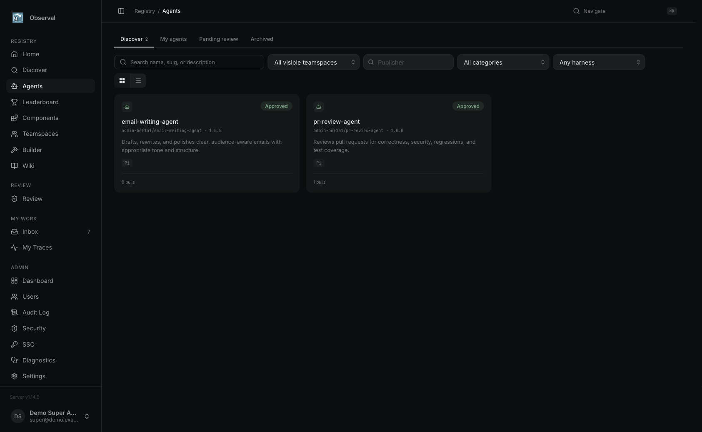

**Build agent files in four steps (identity, behavior, components, review) with a live summary and draft readiness checks:**

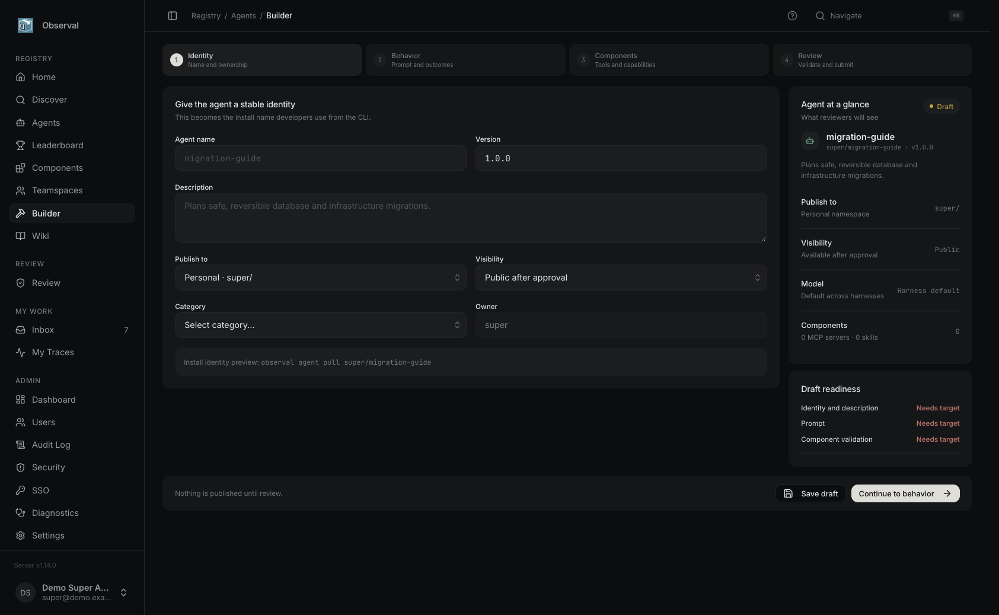

**Component library with tabs for MCP servers, skills, hooks, prompts, and sandboxes:**

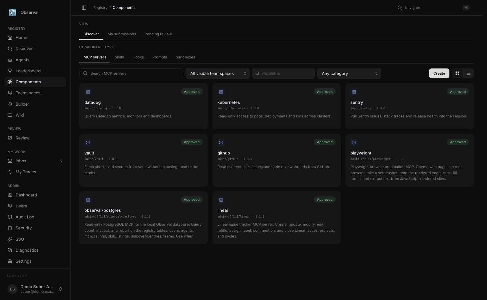

### Fork an approved release

Fork an agent or component into an independent draft in your personal namespace or an eligible teamspace. The source stays unchanged; agent forks retain pinned component references rather than copying components. Reviewers can compare the draft with its approved upstream using **Diff vs upstream**. Public approved direct forks appear on the source's **Forks** tab; private forks and unpublished drafts do not. [Fork and customize guide](docs/use-cases/fork-and-customize.md).

| Registry fork API | Action |
| --- | --- |
| `POST /api/v1/agents/{id}/fork` | Create an agent draft from an approved release |
| `POST /api/v1/{type}/{id}/fork` | Create a component draft (`type`: `mcps`, `skills`, `hooks`, `prompts`, `sandboxes`) |
| `GET /api/v1/agents/{id}/forks`, `GET /api/v1/{type}/{id}/forks` | List public approved direct forks |
| `GET /api/v1/agents/{id}/fork-diff?version=…`, `GET /api/v1/{type}/{id}/fork-diff?version=…` | Compare a visible fork version to its approved, accessible base |

---

## Discovery and Delegation (ARD + A2A)

**ARD: one search across everything approved.** Observal implements [Agentic Resource Discovery](https://github.com/ards-project/ard-spec) (v0.91). Every approved agent, MCP server, skill, hook, prompt and sandbox is published as an ARD entry with a permanent `urn:air:` identifier, a public manifest at `/.well-known/ard.json`, and the spec's search API at `/api/v1/ard/search`. Results are ranked by relevance only; approval, visibility, harness support and whether the resource can be used right now are separate fields. The same visibility rules as the registry apply, so a team-private agent is only found by that team.

**A2A: agents hand tasks to agents.** Observal speaks the [Agent2Agent protocol](https://a2a-protocol.org) (v1.0, with v0.3 compatibility). Every delegation is an A2A Task, whoever runs it:

- **Registry agents** run headless in a harness that supports it (Claude Code, Kiro, Cursor, Codex, OpenCode, Copilot CLI, Antigravity, Pi) inside a throwaway copy of your repository. Their answer comes back as a result, and any file changes come back as a patch that is never applied for you.
- **Remote A2A agents** (a service another team runs, built with any framework) are registered by their Agent Card URL, reviewed like any submission, and then called directly with the card the reviewer approved. Observal never proxies the traffic or stores their credentials.

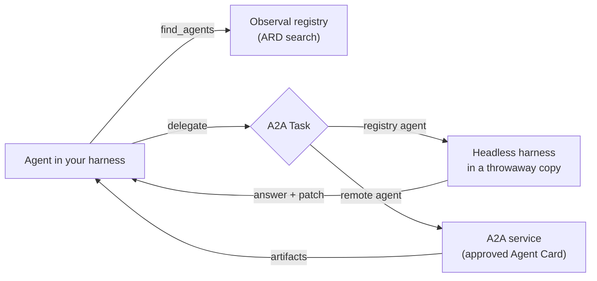

Every agent you pull gets an `observal-agents` MCP server with four tools, `find_agents`, `delegate`, `get_task` and `cancel_task`, so it can do this without being told how. Delegation is limited to approved agents, stops after two levels, lets a delegated agent start at most three tasks of its own, and refuses loops. Each delegation is recorded against the calling session, so traces show which agents a session relied on.

**Discover shows registry agents that can take a task and remote A2A agents side by side:**

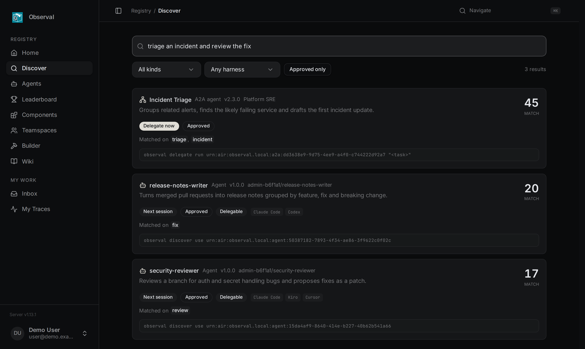

**Delegate from any terminal or script.** Here a remote A2A agent answers directly; a registry agent also hands back its file changes as a patch for you to review:

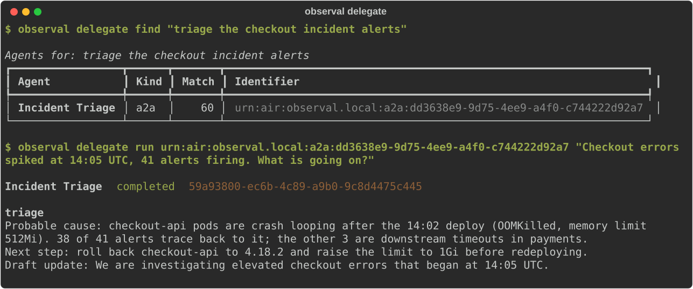

```bash
observal delegate find "review this branch for auth bugs"
observal delegate run acme/security-reviewer "Review src/auth on this branch for token leaks"
git apply ~/.observal/delegations/<task-id>/changes.patch     # only if you agree with it

observal registry a2a submit https://agents.acme.com --visibility team --team platform
observal discover inspect urn:air:agents.acme.com:a2a:incident-triage     # shows the card's Digest
observal registry a2a review urn:air:agents.acme.com:a2a:incident-triage --approve --digest sha256:...
```

Design decisions: [ADR 0001 (ARD)](docs/adr/0001-agentic-resource-discovery.md), [ADR 0002 (A2A delegation)](docs/adr/0002-a2a-delegation.md). API: [Discovery endpoints](docs/reference/api-endpoints.md#discovery-ard).

---

## Coding Agent Insights

**AI-powered insight reports** analyze usage patterns across all sessions, what's working, what's hindering, and quick wins. Powered by [LiteLLM](https://docs.litellm.ai/docs/providers), works with any provider (Anthropic, OpenAI, Bedrock, Gemini, Azure, Ollama).

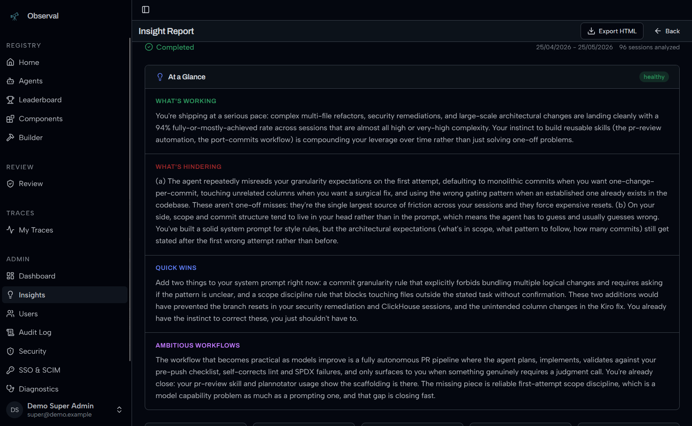

See [Insights LLM Setup](docs/insights-setup.md) for configuration.

---

## Session Replay

**Full session overview with token counts, models, tools, and turn-by-turn timeline:**

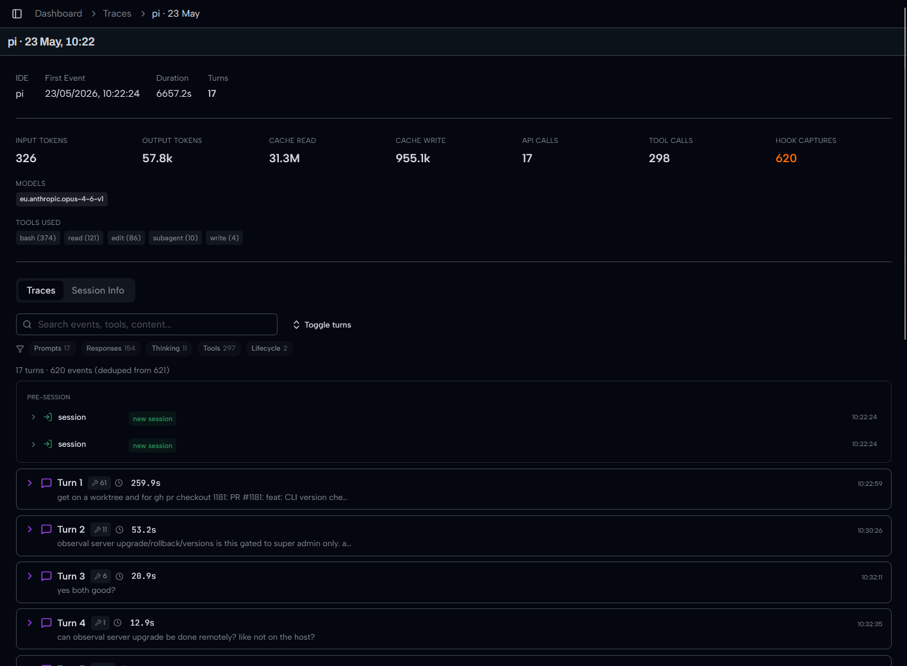

**Every turn captured: user prompt, tool calls, thinking block, assistant response:**

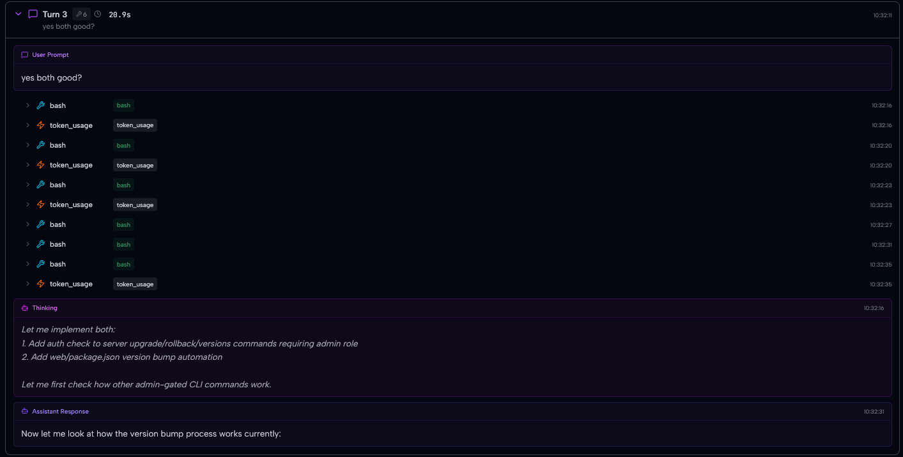

**Drill into any span to see exact tool inputs and outputs:**

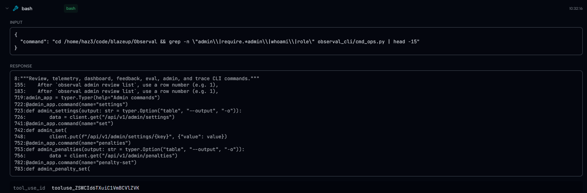

---

## Review and Governance

Authors submit agent and component versions for review. Participants can inspect the submitted revision's redacted files and diffs, discuss changes in conversations, and submit approvals or change requests. Publishing is separate from approval: once the review policy and required checks are satisfied, a reviewer can publish the version, or policy can publish it automatically.

---

## Open-source features

Audit logs, SAML SSO, SCIM provisioning, and the executive dashboard are included in the Apache-2.0 distribution.

**Audit log with filter syntax (`actor:`, `action:`, `outcome:`, `sensitivity:`) and CSV export:**

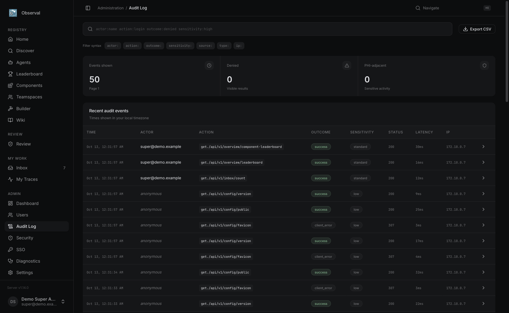

---

## Documentation

Full docs at **[docs.observal.io](https://docs.observal.io/)**.

Start here for deployment and operations:

| Need | Link |
|------|------|
| Fast local or source setup | [SETUP.md](SETUP.md) |
| Self-hosting overview | [docs/self-hosting/README.md](docs/self-hosting/README.md) |
| Production deployment | [docs/self-hosting/production-deploy.md](docs/self-hosting/production-deploy.md) |
| Single-node deployment | [docs/self-hosting/single-node-deploy.md](docs/self-hosting/single-node-deploy.md) |
| Docker Compose setup | [docs/self-hosting/docker-compose.md](docs/self-hosting/docker-compose.md) |
| Databases and migrations | [docs/self-hosting/databases.md](docs/self-hosting/databases.md) |
| Upgrades | [docs/self-hosting/upgrades.md](docs/self-hosting/upgrades.md) |
| Backup and restore | [docs/self-hosting/backup-and-restore.md](docs/self-hosting/backup-and-restore.md) |

---

## Tech Stack

| Layer | Technology |
|-------|-----------|
| Frontend | Vite 8, React 19, TanStack Router, Tailwind CSS 4, shadcn/ui |
| Backend | Python 3.11+, FastAPI, Strawberry GraphQL |
| Databases | PostgreSQL 16 (registry), ClickHouse (telemetry) |
| Queue | Redis + arq |
| CLI | Python, Typer, Rich |
| Telemetry | Session hooks, local transcript reconciliation, push-based ingest |
| Deployment | Docker Compose (10 services), Kubernetes (Helm) |

## Contributing

See [CONTRIBUTING.md](CONTRIBUTING.md). The short version:

1. Fork and clone
2. `make hooks` to install pre-commit hooks
3. Create a feature branch
4. Run `make lint` and `make test`
5. Open a PR

See [AGENTS.md](AGENTS.md) for internal codebase context.

## Community

[GitHub Discussions](https://github.com/Observal/Observal/discussions) for questions and ideas. [Discord](https://discord.observal.io) for chat. Open Issues for confirmed bugs.

## Reporting Issues

```bash
observal doctor support bundle
```

Produces a redacted diagnostic archive. Review before sharing: `observal doctor support inspect observal-support-*.tar.gz`

For live debugging, Observal uses loguru-based dev logging (internally called "optic"). Stream logs with:

```bash
observal ops logs
```

Logs are written to `~/.observal/logs/dev.log` and include structured context for every request, background job, and telemetry event.

## Security

Report vulnerabilities via [GitHub Private Vulnerability Reporting](https://github.com/Observal/Observal/security/advisories) or email contact@observal.io. Do not open a public issue. See [SECURITY.md](SECURITY.md).

## License

Observal is licensed under the Apache License 2.0. See [LICENSE](LICENSE).
